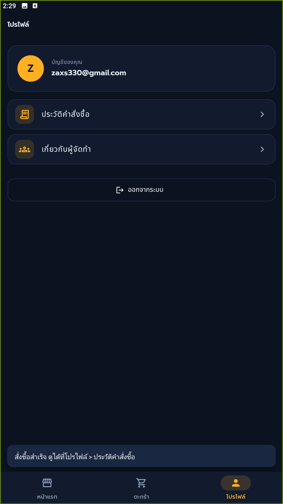

# Bookmark

แอพร้านขายหนังสือออนไลน์ สร้างด้วย Flutter + Supabase
ค้นหาและเรียงหนังสือ เพิ่มลงตะกร้า (มีปุ่ม Undo) และสั่งซื้อได้

## ผู้จัดทำ
- นาย ณพกร พระสุข (@DETH-01)
- นาย พัชรธร จันทะ (@patcharathorn)

## ดาวน์โหลดและเอกสาร
- [ไฟล์ติดตั้ง .apk (Android)](https://github.com/DETH-01/Bookmark-app/releases/latest)
- [รายงาน PDF](docs/report.pdf)
- [วิดีโอแนะนำ](https://drive.google.com/file/d/1B1ZE1oiV6KbBo9hfVpPVuLTEscs271ZY/view?usp=drive_link)

> ติดตั้งบนมือถือ Android: เปิดไฟล์ .apk แล้วอนุญาต "ติดตั้งแอพจากแหล่งที่ไม่รู้จัก"

## ฟีเจอร์
- สมัครสมาชิก / เข้าสู่ระบบ (Supabase Auth)
- รายการหนังสือจากฐานข้อมูล ค้นหาชื่อหรือผู้แต่ง และเลือกวิธีเรียงได้ 4 แบบ
- รายละเอียดหนังสือ เลือกจำนวนและเพิ่มลงตะกร้า
- ตะกร้า แก้จำนวน ลบ และ **ย้อนกลับ (Undo)** การแก้ไข
- สั่งซื้อและดูประวัติคำสั่งซื้อ
- หน้าผู้จัดทำ

## ความรู้จากวิชาโครงสร้างข้อมูลที่ใช้
| หัวข้อ | ใช้ทำอะไร | ไฟล์ |
| Sorting (Merge Sort เขียนเอง) | เรียงหนังสือตามชื่อ ราคา เรตติ้ง | `Bookmark/lib/core/algo/merge_sort.dart` |
| Stack (LIFO) | ปุ่ม Undo ในตะกร้า | `Bookmark/lib/core/ds/stack.dart` |

## ภาพหน้าจอ
    

## วิธีรันจากโค้ด (สำหรับผู้ที่ต้องการทดลอง)
1. คัดลอก `Bookmark/lib/core/config.example.dart` เป็น `config.dart` แล้วใส่ URL และ anon key ของโปรเจค Supabase ตัวเอง
2. รันคำสั่ง `supabase/schema.sql` ใน Supabase SQL Editor
3. `flutter pub get` แล้ว `flutter run`

## เทคโนโลยี
Flutter · Dart · Supabase (Auth + Postgres)
